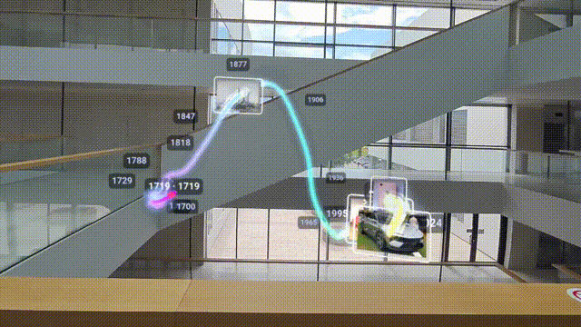
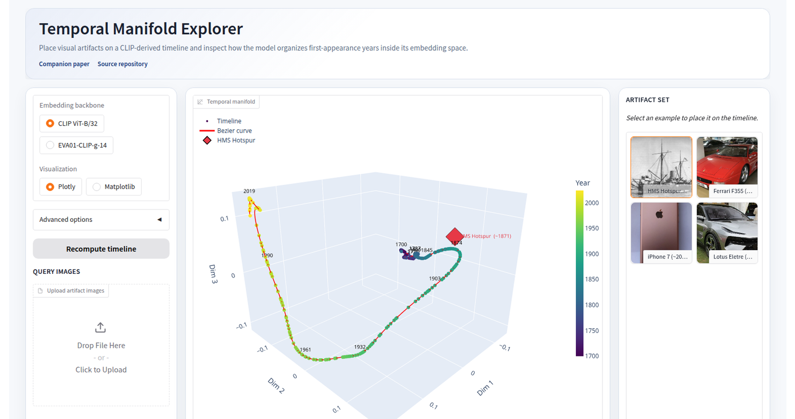

# Timeline-VLM WebXR

The demo (a) renders precomputed CLIP timeline embeddings (years **1700–2024**) as a
3-D point cloud threaded by a learned Bézier *time-axis*, explorable in VR or by
desktop orbit, and (b) estimates the year of an uploaded image by projecting its CLIP
embedding onto that same axis.



The repository ships **two interchangeable frontends** over the same temporal
manifold pipeline. Pick the one you need; both are launched from this repo:

| Entry point | Run with        | URL                       | Best for                                      |
|-------------|------------------|---------------------------|-----------------------------------------------|
| WebXR app   | `python server.py` | `http://localhost:7860`   | Immersive 3-D exploration in VR / desktop orbit |
| Gradio web demo | `python app.py` | `http://localhost:7860` (default) | Lightweight browser-only inspection and image upload |

Everything needed to reproduce the demo is contained in this repository; no training
is required, as the timeline embeddings are precomputed and version-controlled.

---

## Quick start

Four commands to a running demo. CPU is fine; first run downloads ~600 MB of CLIP
weights.

```bash
git clone <repo-url> timeline-xr && cd timeline-xr
git lfs install && git lfs pull              # resolve the precomputed embeddings
pip install -r requirements.txt              # see the torch note in §2 if a wheel is missing
python app.py     # Gradio web demo  → http://localhost:7860
# or
python server.py  # WebXR app        → http://localhost:7860
```

Open the URL, click an example artifact (or upload your own image), and watch it
snap to its estimated year on the Bézier time-axis. That's the whole demo.

> Need a headset, Docker, the HTTP API, or the verification script? Sections
> below cover each. New here? Read §5 (WebXR) or §6 (Gradio) next — they each
> stand alone.

---

## 1. System overview

| Component | Implementation | File(s) |
|-----------|----------------|---------|
| WebXR backend  | Standalone FastAPI server (~360 lines), serves scene JSON + image prediction | `server.py` |
| WebXR frontend | Plain Three.js (CDN, no build step) + WebXR | `webxr/index.html`, `webxr/app.js`, `webxr/phone.html` |
| Gradio web demo | Single-file Gradio app, 3-D Plotly/Matplotlib view and image upload | `app.py` |
| Data | Precomputed timeline embeddings + per-year labels (Git LFS) | `encodings/` |
| Demo images | Bundled example artifacts (shelf in VR, gallery in the web demo) | `examples/` |
| Encoder | CLIP ViT-B/32 (`openai/clip-vit-base-patch32`), downloaded on first run | (HF Hub) |


---

## 2. Requirements

### Software
- **Python 3.11–3.13.** Local development was pinned to `3.11.9` (`.tool-versions`);
  the Docker image uses `python:3.13-slim`. Either works with the pinned wheels.
- **Git LFS** — required; embeddings and example images are LFS-tracked.
- Python dependencies (`requirements.txt`):
  ```
  torch==2.6.0
  torchvision==0.21.0
  transformers==4.47.0
  Pillow
  scikit-learn
  numpy

  # WebXR backend (server.py)
  fastapi
  uvicorn[standard]
  python-multipart

  # Gradio web demo (app.py)
  gradio
  plotly
  matplotlib
  ```

### Hardware
- **CPU is sufficient.** The model auto-selects CUDA if available
  (`server.py:120`), but inference is a single CLIP forward pass per image, so a
  GPU is not required to reproduce results.
- ~600 MB disk for the CLIP weights (one `model.safetensors`, cached by
  `transformers` on first run).
- For VR: any WebXR-capable headset (e.g. Meta Quest) with a browser. WebXR requires
  a secure context (`https://` or `localhost`).

### Determinism note
KernelPCA, the Bézier fit, and the projection are all deterministic given fixed
input embeddings — there is no random seed to set. Reproducing the visualization and
predictions therefore depends only on the LFS data + the CLIP weights resolving to
the same checkpoint (`openai/clip-vit-base-patch32`). Minor floating-point
differences across CPU/GPU/BLAS backends may shift a marker by a sub-millimetre but
do not change predicted years on the bundled examples.

---

## 3. Data

`encodings/` holds the precomputed timeline embeddings and their year labels. Each
`.npy` is one CLIP/EVA embedding per year; the parallel `.txt` lists one year per
line (verified equal row counts).

| Backbone | Embeddings | Shape / dtype | Labels | Rows |
|----------|------------|---------------|--------|------|
| `clip` | `encodings/timeline_embeddings.npy` | `(325, 512)` float32 | `encodings/timeline_labels.txt` | 325 |
| `eva` | `encodings/eva/eva_timeline_embeddings.npy` | `(324, 512)` float16 | `encodings/eva/eva_labels_timeline.txt` | 324 |

`DATA_PATHS` (`server.py:44`) maps each backbone to its `{embeddings, labels}` pair.

> **Provenance.** These embeddings are the precomputed temporal-manifold features
> from the upstream paper/demo; this repo redistributes them via Git LFS and does
> not regenerate them. Image *prediction* is **clip-only** — CLIP ViT-B/32 is the
> only encoder loaded, so `/api/predict` rejects `backbone != "clip"`
> (`server.py:200`). The `eva` backbone is for timeline visualization only.

---

## 4. Install once

```bash
git clone <repo-url> timeline-xr && cd timeline-xr
git lfs install                     # one-time
git lfs pull                        # REQUIRED — resolves the .npy / .jpg blobs
python -m venv .venv && source .venv/bin/activate
pip install -r requirements.txt     # see torch note below
```

- **torch note:** if the pinned `torch==2.6.0` / `torchvision==0.21.0` wheels are
  unavailable for your interpreter/platform, install the matching builds for your
  platform instead — the pipeline does not depend on the exact patch version.

After the install, pick **one** of the two entry points below.

---

## 5. Entry point A — WebXR app (`server.py`)

```bash
python server.py                    # serves on http://0.0.0.0:7860
```

Open **http://localhost:7860** — desktop works immediately: drag to orbit, scroll to
zoom, toggle raw embeddings, and upload an image to estimate its year.

On startup the server loads the default `clip` scene and prints `Timeline scene
ready.` (`server.py:361`). If the embeddings are still LFS pointers it instead prints
a `WARNING:` line telling you to run `git lfs pull`.

- **`PORT` override:** `PORT=8080 python server.py`.
- The server reads `webxr/` fresh per request, so frontend edits show on refresh
  with no restart.

---

## 6. Entry point B — Gradio web demo (`app.py`)

A zero-config browser UI: select a backbone, optionally pick a bundled example or
upload your own images, and watch them snap to the Bézier time-axis with their
estimated year.

```bash
python app.py                       # launches Gradio on http://0.0.0.0:7860
```

Open **http://localhost:7860**. The left panel chooses the backbone (CLIP / EVA),
the visualization (Plotly / Matplotlib), and exposes Bézier control points + a
"show raw embeddings" toggle under *Advanced*. The right panel lists the bundled
artifacts; click one to drop it onto the manifold. The centre panel shows the 3-D
plot and a prediction table.



- **Port override:** `GRADIO_SERVER_PORT=8080 python app.py`.
- **Public share link:** `GRADIO_SHARE=1 python app.py` produces a temporary
  `*.gradio.live` URL (useful for showing the demo to someone on a different
  network).
- **Backbones.** Both CLIP ViT-B/32 and EVA01-CLIP-g-14 can drive the timeline;
  switch between them in the left panel to compare placements. Uploaded images
  are always encoded by CLIP ViT-B/32, so the projected year for an upload comes
  from CLIP's view of the manifold regardless of which timeline is on screen
  (`server.py:198` enforces the same constraint at the HTTP boundary).

---

## 7. Docker

The image installs `git-lfs`, resolves LFS blobs at build, and pre-downloads CLIP so
the first request is instant and runtime needs no Hugging Face access. The default
`CMD` runs the **WebXR backend** (`server.py`).

```bash
docker build -t timeline-vlm-xr .
docker run -p 7860:7860 timeline-vlm-xr
# → http://localhost:7860
```

To run the **Gradio web demo** from the same image instead:

```bash
docker run -p 7860:7860 timeline-vlm-xr python app.py
```

Notes for reviewers building the image:
- The build runs `git lfs pull || true`. If your build context already contains the
  real blobs (e.g. you ran `git lfs pull` before building), they are used directly;
  otherwise the build attempts to fetch them. **Confirm the blobs are present in the
  context** for a fully offline, reproducible build.
- A `HEALTHCHECK` probes `/` via `urllib` (the slim image has no `curl`).
- `python:3.13-slim` matches the pinned torch wheels.

### Compose / deployment (optional)
- `docker-compose.yml` runs the container behind a Traefik reverse proxy with
  automatic Let's Encrypt TLS (used for the public headset-accessible deployment).
  It expects an external `proxy` network and is **not** needed to reproduce results.
  and publishes port 7860 directly (no Traefik). `docker compose up` auto-merges it;
  to reproduce the production setup, run `docker compose -f docker-compose.yml up`.

---

## 8. Method / pipeline (what to reproduce)

Both `server.py` and `app.py` implement the same deterministic pipeline; the
line references below are to `server.py`.

1. **Load** precomputed embeddings + year labels for the backbone
   (`_load_embeddings`, `server.py:86`). Years that don't parse as `int` default to
   `1900` (`build_kpca_and_curve`, `server.py:71`).
2. **Reduce** the embeddings to 3-D with
   `KernelPCA(n_components=3, kernel="cosine")` (`server.py:76`).
3. **Fit a Bézier time-axis:** sample `n_ctrl` evenly-spaced control points from the
   year-ordered reduced points and evaluate a 1000-point Bézier via De Casteljau
   (`bezier_curve` / `_de_casteljau`, `server.py:52–60`). Default `n_ctrl=300`.
4. **Project** every timeline point onto its nearest curve point
   (`project_onto_curve`, `server.py:63`) — this snaps the cloud onto the smooth axis.
5. **Normalize** (WebXR only) the cloud + curve into a ~2 m cube (`CUBE_EDGE = 2.0`,
   `_fit_normalizer` / `_apply_norm`, `server.py:104–116`) so the scene is
   comfortable at room scale in VR. The fitted center+scale are stored per backbone
   so user predictions land in the same coordinate frame.
6. **Serve** the scene JSON (WebXR) or render directly in Plotly/Matplotlib (Gradio).

**Prediction** (`/api/predict`, `server.py:194`, and `build_figure_*` in `app.py`):
CLIP-encode the uploaded image → transform by the **same fitted KPCA** →
`project_onto_curve` onto the same curve → take the timeline label nearest (by curve
index) to the projected point as the **predicted year** → render a marker in the
scene / table. In `server.py` inference is serialized under `_PREDICT_LOCK` because
the model/sklearn state is not thread-safe.

---

## 9. HTTP API surface (WebXR backend)

| Method & path | Purpose |
|---------------|---------|
| `GET /` | `webxr/index.html` (app.js URL is mtime-stamped to bust caches) |
| `GET /api/timeline?backbone=clip&n_ctrl=300` | Scene JSON: `points`, `rawPoints`, `curve`, `years`, `labels`, `yearRange` |
| `POST /api/predict?backbone=clip` (multipart `file`) | `{name, year, position}` — `backbone` is a query parameter (default `clip`) |
| `GET /api/examples` | Bundled demo image filenames (in-headset shelf) |
| `GET /phone`, `POST /api/share`, `GET /api/share/stream` (SSE), `GET /api/share/img/{id}` | Phone → headset photo sharing (demo convenience; not part of the method) |

---

## 10. Verifying a successful reproduction

After `python server.py` (or the Docker container) is up:

```bash
# 1. Scene JSON loads and spans the full year range.
curl -s 'http://localhost:7860/api/timeline?backbone=clip' \
  | python -c "import sys,json; d=json.load(sys.stdin); print('yearRange', d['yearRange'], 'points', len(d['points']))"
# expected: yearRange [1700, 2024]  points 325

# 2. Image prediction returns a plausible year for a bundled example.
#    (backbone is a query parameter, not a form field.)
curl -s -F file=@examples/iPhone_2016.jpg \
  'http://localhost:7860/api/predict?backbone=clip'
# expected: {"name":"iPhone_2016.jpg","year":"2015","position":[...]}

# 3. Non-clip prediction is rejected (documented limitation).
curl -s -F file=@examples/iPhone_2016.jpg \
  'http://localhost:7860/api/predict?backbone=eva'
# expected: HTTP 400, "Image prediction is only available with the 'clip' backbone."
```

For the Gradio web demo (`python app.py`), open `http://localhost:7860`, click any
artifact in the right-hand gallery, and confirm a diamond marker appears on the
manifold with its estimated year listed in the Predictions table below the plot.

Bundled examples (with their ground-truth years in the filename) for qualitative
checking: `Ferrari_1994.jpg`, `HMS_Hotspur_1870.jpg`, `Lotus_2022.jpg`,
`iPhone_2016.jpg`.

> Prediction reproduces the upstream pipeline; treat the per-image estimates as
> demonstrative, not as a benchmark. The contribution of *this* artifact is the
> immersive WebXR rendering and interaction, not new accuracy numbers.

---

## 11. Reproducing the VR experience

WebXR needs a secure context. To put the demo on a headset over your LAN:

1. Run the server (local or Docker).
2. Expose it over **HTTPS** — e.g. a reverse proxy with TLS (see
   `docker-compose.yml` + Traefik) or an HTTPS tunnel. `localhost` is exempt from
   the HTTPS requirement for same-device testing.
3. In the headset browser, open the HTTPS URL. The **"Enter VR"** button appears
   when an `immersive-vr` device is detected.

**Controls:** *Trigger* (either controller) grabs the model to move/rotate it;
*right thumbstick* (vertical) scales it. Desktop: drag to orbit, scroll to zoom.
